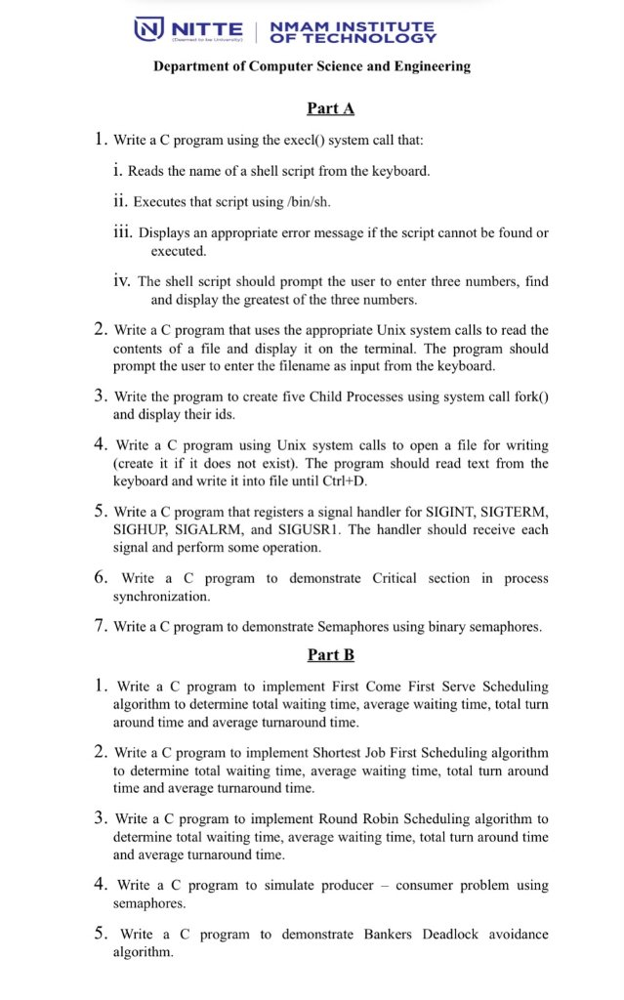

# Operating Systems Laboratory: Exam Reference & Complete Code Manual

> **NMAM Institute of Technology, Nitte**  
> **Department of Computer Science and Engineering**  
> **Operating Systems Laboratory (Academic Year 2026–27)**  
> Complete implementation, verified outputs, Gantt charts, and viva reference strictly organized in official lab examination order.

---

## 📋 Official Exam Question Paper

Below is the official lab examination question set. All programs in this repository follow this exact numbering, ordering, and specification.

<p align="center">
  
</p>

---

## Table of Contents
1. [Official Exam Order Index](#quick-reference-index-official-exam-order)
2. [Environment & System Prerequisites](#environment--system-prerequisites)
3. [Makefile & Automated Compilation](#makefile--automated-compilation)
4. **Part A: System Calls, Processes & Synchronization**
   - [Part A - Program 1: `execl()` System Call](#part-a---program-1-execl-system-call)
   - [Part A - Program 2: Read Contents of a File using Unix System Calls](#part-a---program-2-read-contents-of-a-file-using-unix-system-calls)
   - [Part A - Program 3: Create Five Child Processes using `fork()`](#part-a---program-3-create-five-child-processes-using-fork)
   - [Part A - Program 4: Open File for Writing until Ctrl+D using Unix System Calls](#part-a---program-4-open-file-for-writing-until-ctrld-using-unix-system-calls)
   - [Part A - Program 5: Signal Handler for SIGINT, SIGTERM, SIGHUP, SIGALRM, and SIGUSR1](#part-a---program-5-signal-handler-for-sigint-sigterm-sighup-sigalrm-and-sigusr1)
   - [Part A - Program 6: Critical Section in Process Synchronization (Mutex)](#part-a---program-6-critical-section-in-process-synchronization-mutex)
   - [Part A - Program 7: Semaphores using Binary Semaphores](#part-a---program-7-semaphores-using-binary-semaphores)
5. **Part B: CPU Scheduling, Bounded Buffer & Deadlock Avoidance**
   - [Part B - Program 1: First Come First Serve (FCFS) Scheduling](#part-b---program-1-first-come-first-serve-fcfs-scheduling)
   - [Part B - Program 2: Shortest Job First (SJF) Scheduling](#part-b---program-2-shortest-job-first-sjf-scheduling)
   - [Part B - Program 3: Round Robin Scheduling](#part-b---program-3-round-robin-scheduling)
   - [Part B - Program 4: Simulate Producer - Consumer Problem using Semaphores](#part-b---program-4-simulate-producer---consumer-problem-using-semaphores)
   - [Part B - Program 5: Banker’s Deadlock Avoidance Algorithm](#part-b---program-5-bankers-deadlock-avoidance-algorithm)
6. [Quick Viva Cheat Sheet](#quick-viva-cheat-sheet)
7. [Troubleshooting & Common Errors](#troubleshooting--common-errors)
8. [Comprehensive OS Theory & System Internals Walkthrough](./WALKTHROUGH.md)

---

## Quick Reference Index (Official Exam Order)

### Part A

| # | Official Exam Question Title | Core Concepts | Key System Calls / Functions | Source Code Folder |
|:---:|---|---|---|:---:|
| **1** | **`execl()` System Call** | Process replacement, shell execution | `execl()`, `access()`, `largest.sh` | [Part-A/Program-1-execl-system-call/](./Part-A/Program-1-execl-system-call/) |
| **2** | **File Read using Unix System Calls** | Low-level unbuffered stream I/O | `open(O_RDONLY)`, `read()`, `write()`, `close()` | [Part-A/Program-2-file-read-system-calls/](./Part-A/Program-2-file-read-system-calls/) |
| **3** | **Five Child Processes using `fork()`** | Process hierarchy, synchronization | `fork()`, `getpid()`, `getppid()`, `wait()`, `exit()` | [Part-A/Program-3-fork-child-processes/](./Part-A/Program-3-fork-child-processes/) |
| **4** | **File Write until Ctrl+D using System Calls** | File creation, EOF capture | `open(O_CREAT\|O_WRONLY\|O_TRUNC)`, `read(0,...)`, `write()` | [Part-A/Program-4-file-write-system-calls/](./Part-A/Program-4-file-write-system-calls/) |
| **5** | **Signal Handler (SIGINT, SIGTERM, etc.)** | Asynchronous software interrupts | `signal()`, `alarm()`, `kill`, `sleep()` | [Part-A/Program-5-signal-handling/](./Part-A/Program-5-signal-handling/) |
| **6** | **Critical Section using Mutex Lock** | Multithreaded mutual exclusion | `pthread_create()`, `pthread_mutex_lock()`, `pthread_mutex_unlock()` | [Part-A/Program-6-mutex-critical-section/](./Part-A/Program-6-mutex-critical-section/) |
| **7** | **Semaphores using Binary Semaphores** | Process/thread synchronization | `sem_init()`, `sem_wait()`, `sem_post()`, `sem_destroy()` | [Part-A/Program-7-binary-semaphores/](./Part-A/Program-7-binary-semaphores/) |

### Part B

| # | Official Exam Question Title | Core Concepts | Key Metrics / Logic | Source Code Folder |
|:---:|---|---|---|:---:|
| **1** | **First Come First Serve (FCFS) Scheduling** | Non-preemptive queue scheduling | $BT$, $WT$, $TAT$, $AWT$, $ATAT$, Gantt chart | [Part-B/Program-1-fcfs-scheduling/](./Part-B/Program-1-fcfs-scheduling/) |
| **2** | **Shortest Job First (SJF) Scheduling** | Optimal non-preemptive scheduling | Ascending burst sort, arrival tie-breaker, Gantt chart | [Part-B/Program-2-sjf-scheduling/](./Part-B/Program-2-sjf-scheduling/) |
| **3** | **Round Robin (RR) Scheduling** | Preemptive time-slicing | Time Quantum ($tq$), Cyclic ready queue, Gantt chart | [Part-B/Program-3-round-robin-scheduling/](./Part-B/Program-3-round-robin-scheduling/) |
| **4** | **Producer - Consumer Problem Simulation** | Bounded buffer queue simulation | Circular array, modular arithmetic `(in+1)%bs` | [Part-B/Program-4-producer-consumer/](./Part-B/Program-4-producer-consumer/) |
| **5** | **Banker’s Deadlock Avoidance Algorithm** | Multi-resource safety algorithm | Max, Allocation, Need matrices, Safe Sequence | [Part-B/Program-5-bankers-algorithm/](./Part-B/Program-5-bankers-algorithm/) |

---

## Environment & System Prerequisites

| Component | Minimum Version | Recommended Version | Verification Command | Notes |
|---|---|---|---|---|
| **Operating System** | Ubuntu 20.04+ / macOS 11+ | **Ubuntu 22.04 LTS / Debian 12** | `uname -a` | Standard college lab OS |
| **C Compiler** | GCC 9.0+ / Clang 11+ | **GCC 11.0+** | `gcc --version` | Supports `-Wall -Wextra -pthread` |
| **Build Automation** | GNU Make 4.0+ | **GNU Make 4.3+** | `make --version` | Rapid batch compilation |
| **POSIX Shell** | Bash 4.0+ / Dash | **GNU Bash 5.0+** | `bash --version` | For `largest.sh` (Part A, Program 1) |

---

## Makefile & Automated Compilation

A top-level [`Makefile`](./Makefile) allows compiling and testing all programs in both parts with a single terminal command:

```bash
# Compile all 12 exam programs at once:
make all

# Clean all generated binary executables:
make clean

# Build any specific exam program:
make Part-A/Program-1-execl-system-call/main
make Part-A/Program-6-mutex-critical-section/main
make Part-B/Program-5-bankers-algorithm/main
```

---

## Part A: System Calls, Processes & Synchronization

### Part A - Program 1: `execl()` System Call

#### 📝 Exam Question
**Write a C program using the `execl()` system call that:**
- **i.** Reads the name of a shell script from the keyboard.
- **ii.** Executes that script using `/bin/sh`.
- **iii.** Displays an appropriate error message if the script cannot be found or executed.
- **iv.** The shell script should prompt the user to enter three numbers, find and display the greatest of the three numbers.

#### Source Code

##### `main.c`
```c
#include <stdio.h>
#include <stdlib.h>
#include <unistd.h>

int main() {
    char sname[100];
    printf("Enter shell script name: ");
    scanf("%99s", sname);
    /* the script must exist and be readable */
    if (access(sname, R_OK) == -1) {
        perror("Error: cannot open script");
        return 1;
    }
    if (execl("/bin/sh", "sh", sname, (char*)NULL) == -1)
        perror("Error: cannot execute script");

    return 0;
}
```

##### `largest.sh`
```bash
#!/bin/bash
read -p "Enter 3 numbers: " a b c
if [ $a -ge $b ] && [ $a -ge $c ]
then
    echo "$a is the greatest"
elif [ $b -ge $a ] && [ $b -ge $c ]
then
    echo "$b is the greatest"
else
    echo "$c is the greatest"
fi
```

#### Compilation & Output
```bash
gcc main.c -o a.out
chmod +x largest.sh
./a.out
Enter shell script name: largest.sh
Enter 3 numbers: 3 4 2
4 is the greatest

./a.out
Enter shell script name: large.sh
Error: cannot open script: No such file or directory
```

---

### Part A - Program 2: Read Contents of a File using Unix System Calls

#### 📝 Exam Question
**Write a C program that uses the appropriate Unix system calls to read the contents of a file and display it on the terminal. The program should prompt the user to enter the filename as input from the keyboard.**

#### Source Code (`main.c`)
```c
#include <stdio.h>
#include <stdlib.h>
#include <unistd.h>
#include <fcntl.h>

int main()
{
    char fname[100], buffer[100];
    int fd;
    ssize_t n;
    printf("Enter filename: ");
    scanf("%99s", fname);
    fd = open(fname, O_RDONLY);
    if (fd == -1)
    {
        perror("Error");
        return 1;
    }
    printf("file contents:\n");
    /* flush stdio before using write() directly */
    fflush(stdout);
    /* keep reading until end of file */
    while ((n = read(fd, buffer, sizeof(buffer))) > 0)
    {
        if (write(STDOUT_FILENO, buffer, n) != n)
        {
            perror("Error");
            break;
        }
    }
    if (n == -1)
        perror("Error");
    close(fd);
    return 0;
}
```

#### Compilation & Output
```bash
gcc main.c -o a.out
./a.out
Enter filename: contents.txt
file contents:
Hello World

./a.out
Enter filename: cont.txt
Error: No such file or directory
```

---

### Part A - Program 3: Create Five Child Processes using `fork()`

#### 📝 Exam Question
**Write the program to create five Child Processes using system call fork() and display their ids.**

#### Source Code (`main.c`)
```c
#include <stdio.h>
#include <stdlib.h>
#include <unistd.h>
#include <sys/wait.h>

int main()
{
    int i;
    pid_t pid;
    for (i = 1; i <= 5; i++) {
        /* flush so the child does not copy unflushed output */
        fflush(stdout);
        pid = fork();
        if (pid < 0)
        {
            printf("Error ");
            return 1;
        } else if (pid == 0) {
            printf("Child %d with id %d and Parent Process id %d\n",
                   i, getpid(), getppid());
            exit(0);
        } else {
            printf("Parent Created Child %d with pid %d\n",
                   i, pid);
        }
    }
    for (i = 1; i <= 5; i++)
    {
        wait(NULL);
    }
    printf("Parent pid %d after finishing all Child execution\n",
           getpid());
    return 0;
}
```

#### Compilation & Output
```bash
gcc main.c -o a.out
./a.out
Parent Created Child 1 with pid 414
Child 1 with id 414 and Parent Process id 413
Parent Created Child 2 with pid 415
Child 2 with id 415 and Parent Process id 413
Parent Created Child 3 with pid 416
Child 3 with id 416 and Parent Process id 413
Parent Created Child 4 with pid 417
Child 4 with id 417 and Parent Process id 413
Parent Created Child 5 with pid 418
Child 5 with id 418 and Parent Process id 413
Parent pid 413 after finishing all Child execution
```

---

### Part A - Program 4: Open File for Writing until Ctrl+D using Unix System Calls

#### 📝 Exam Question
**Write a C program using Unix system calls to open a file for writing (create it if it does not exist). The program should read text from the keyboard and write it into file until Ctrl+D.**

#### Source Code (`main.c`)
```c
#include <stdio.h>
#include <stdlib.h>
#include <fcntl.h>
#include <unistd.h>

int main()
{
    int fd;
    char buffer[1000], fname[100];
    printf("Enter the filename to be written \n");
    scanf("%99s", fname);
    fd = open(fname, O_CREAT | O_WRONLY | O_TRUNC, 0644);
    if (fd == -1)
    {
        printf("Open error");
        return 0;
    }
    printf("Enter the contents to be written \n");
    while (1)
    {
        int n = read(0, buffer, sizeof(buffer));
        if (n > 0) {
            write(fd, buffer, n);
        }
        else if (n == 0) {
            break;
        }
        else {
            printf("Read error");
            close(fd);
            return 0;
        }
    }
    close(fd);
    printf("Contents written to %s\n", fname);
    return 0;
}
```

#### Compilation & Output
```bash
gcc main.c -o a.out
./a.out
Enter the filename to be written 
contents.txt
Enter the contents to be written 
hello world
Contents written to contents.txt

cat contents.txt
hello world
```

---

### Part A - Program 5: Signal Handler for SIGINT, SIGTERM, SIGHUP, SIGALRM, and SIGUSR1

#### 📝 Exam Question
**Write a C program that registers a signal handler for SIGINT, SIGTERM, SIGHUP, SIGALRM, and SIGUSR1. The handler should receive each signal and perform some operation.**

#### Source Code (`main.c`)
```c
#include <stdio.h>
#include <stdlib.h>
#include <unistd.h>
#include <signal.h>

void signalhandler(int sig)
{
    if (sig == SIGINT)
    {
        printf("Caught an Interrupt Signal\n");
    }
    if (sig == SIGTERM)
    {
        printf("Caught a Terminate Signal\n");
        exit(0);
    }
    if (sig == SIGHUP) {
        printf("Caught a Hangup Signal\n");
    }
    if (sig == SIGUSR1)
    {
        printf("Caught a User Signal\n");
    }
    if (sig == SIGALRM)
    {
        printf("Caught an Alarm Signal\n");
    }
}

int main()
{
    signal(SIGINT, signalhandler);
    signal(SIGTERM, signalhandler);
    signal(SIGHUP, signalhandler);
    signal(SIGALRM, signalhandler);
    signal(SIGUSR1, signalhandler);
    alarm(20);
    printf("Process Id of program running = %d\n", getpid());
    while (1)
    {
        printf("Waiting for signal\n");
        sleep(5);
    }
    return 0;
}
```

#### Execution & Output
- **Terminal 1:**
  ```text
  gcc main.c
  ./a.out
  Process Id of program running = 430
  Waiting for signal
  Caught an Interrupt Signal
  Waiting for signal
  Caught a Hangup Signal
  Waiting for signal
  Caught a User Signal
  Waiting for signal
  Caught an Alarm Signal
  Waiting for signal
  Caught a Terminate Signal
  ```
- **Terminal 2:**
  ```bash
  kill -SIGINT 430
  kill -SIGHUP 430
  kill -SIGUSR1 430
  kill -SIGALRM 430
  kill -SIGTERM 430
  ```

---

### Part A - Program 6: Critical Section in Process Synchronization (Mutex)

#### 📝 Exam Question
**Write a C program to demonstrate Critical section in process synchronization.**

#### Source Code (`main.c`)
```c
#include <stdio.h>
#include <stdlib.h>
#include <unistd.h>
#include <pthread.h>

int shared_counter = 0;
pthread_mutex_t mutex;

void *increment_counter(void *arg) {
    int thread_id = *(int *)arg;
    printf("Thread %d: Waiting to enter critical section..\n", thread_id);
    pthread_mutex_lock(&mutex);
    printf("Thread %d: Entered critical section.\n", thread_id);
    shared_counter++;
    printf("Thread %d: Incremented counter to %d\n", thread_id,
           shared_counter);
    sleep(1);
    printf("Thread %d: Exiting critical section.\n", thread_id);
    pthread_mutex_unlock(&mutex);
    return NULL;
}

int main()
{
    pthread_t threads[3];
    int thread_ids[3] = {1, 2, 3};
    pthread_mutex_init(&mutex, NULL);
    for (int i = 0; i < 3; i++) {
        pthread_create(&threads[i], NULL, increment_counter,
                       &thread_ids[i]);
    }
    for (int i = 0; i < 3; i++) {
        pthread_join(threads[i], NULL);
    }
    pthread_mutex_destroy(&mutex);
    printf("Final value of shared counter: %d\n", shared_counter);
    return 0;
}
```

#### Compilation & Output
```bash
gcc main.c -lpthread -o a.out
./a.out
Thread 1: Waiting to enter critical section..
Thread 1: Entered critical section.
Thread 1: Incremented counter to 1
Thread 2: Waiting to enter critical section..
Thread 3: Waiting to enter critical section..
Thread 1: Exiting critical section.
Thread 2: Entered critical section.
Thread 2: Incremented counter to 2
Thread 2: Exiting critical section.
Thread 3: Entered critical section.
Thread 3: Incremented counter to 3
Thread 3: Exiting critical section.
Final value of shared counter: 3
```

---

### Part A - Program 7: Semaphores using Binary Semaphores

#### 📝 Exam Question
**Write a C program to demonstrate Semaphores using binary semaphores.**

#### Source Code (`main.c`)
```c
#include <stdio.h>
#include <stdlib.h>
#include <unistd.h>
#include <pthread.h>
#include <semaphore.h>

sem_t semaphore;

void *thread_function(void *arg) {
    int thread_id = *(int *)arg;
    printf("Thread %d: Waiting to enter critical section..\n", thread_id);
    sem_wait(&semaphore);
    printf("Thread %d: Entered critical section.\n", thread_id);
    sleep(1);
    printf("Thread %d: Leaving critical section.\n", thread_id);
    sem_post(&semaphore);
    return NULL;
}

int main()
{
    pthread_t threads[3];
    int thread_ids[3] = {1, 2, 3};
    sem_init(&semaphore, 0, 1); /* binary semaphore: initial value 1 */
    for (int i = 0; i < 3; i++) {
        pthread_create(&threads[i], NULL, thread_function,
                       &thread_ids[i]);
    }
    for (int i = 0; i < 3; i++) {
        pthread_join(threads[i], NULL);
    }
    sem_destroy(&semaphore);
    printf("All threads have finished execution.\n");
    return 0;
}
```

#### Compilation & Output
```bash
gcc main.c -lpthread -o a.out
./a.out
Thread 1: Waiting to enter critical section..
Thread 1: Entered critical section.
Thread 2: Waiting to enter critical section..
Thread 3: Waiting to enter critical section..
Thread 1: Leaving critical section.
Thread 2: Entered critical section.
Thread 2: Leaving critical section.
Thread 3: Entered critical section.
Thread 3: Leaving critical section.
All threads have finished execution.
```

---

## Part B: CPU Scheduling, Bounded Buffer & Deadlock Avoidance

### Part B - Program 1: First Come First Serve (FCFS) Scheduling

#### 📝 Exam Question
**Write a C program to implement First Come First Serve Scheduling algorithm to determine total waiting time, average waiting time, total turn around time and average turnaround time.**

#### Source Code (`main.c`)
```c
#include <stdio.h>
#include <stdlib.h>
#include <unistd.h>
#include <sys/wait.h>

struct Process
{
    int pid, bt, wt, tat;
};

int main()
{
    int n, i;
    double awt = 0, atat = 0;
    printf("Enter number of processes: ");
    scanf("%d", &n);
    if (n <= 0)
    {
        printf("Number of processes must be positive\n");
        return 1;
    }
    struct Process P[n];
    for (i = 0; i < n; i++)
    {
        P[i].pid = i + 1;
        printf("Enter burst time for P%d: ", i + 1);
        scanf("%d", &P[i].bt);
    }
    P[0].wt = 0;
    P[0].tat = P[0].bt + P[0].wt;
    for (i = 1; i < n; i++)
    {
        P[i].wt = P[i - 1].wt + P[i - 1].bt;
        P[i].tat = P[i].bt + P[i].wt;
    }
    printf("\n Process BT\t WT\t TAT\t");
    for (i = 0; i < n; i++)
    {
        printf("\n %d\t %d\t %d\t %d ", P[i].pid, P[i].bt, P[i].wt,
               P[i].tat);
    }
    for (i = 0; i < n; i++)
    {
        awt += P[i].wt;
        atat += P[i].tat;
    }
    printf("\n\nTotal Waiting Time = %.2f\n", awt);
    printf("Average Waiting Time = %.2f\n", awt / n);
    printf("Total Turn Around Time = %.2f\n", atat);
    printf("Average Turn Around Time = %.2f\n", atat / n);
    return 0;
}
```

#### Compilation & Output
```bash
gcc main.c -o a.out
./a.out
Enter number of processes: 4
Enter burst time for P1: 3
Enter burst time for P2: 4
Enter burst time for P3: 2
Enter burst time for P4: 5

 Process BT	 WT	 TAT	
 1	 3	 0	 3 
 2	 4	 3	 7 
 3	 2	 7	 9 
 4	 5	 9	 14 

Total Waiting Time = 19.00
Average Waiting Time = 4.75
Total Turn Around Time = 33.00
Average Turn Around Time = 8.25
```

#### Gantt Chart
```text
+-------+-------+-----+---------+
|  P1   |  P2   | P3  |   P4    |
+-------+-------+-----+---------+
0       3       7     9        14
```

---

### Part B - Program 2: Shortest Job First (SJF) Scheduling

#### 📝 Exam Question
**Write a C program to implement Shortest Job First Scheduling algorithm to determine total waiting time, average waiting time, total turn around time and average turnaround time.**

#### Source Code (`main.c`)
```c
#include <stdio.h>
#include <stdlib.h>
#include <unistd.h>
#include <sys/wait.h>

struct Process
{
    int pid, bt, wt, tat;
};

int main()
{
    int n, min;
    double awt = 0, atat = 0;
    printf("Enter no of process: ");
    scanf("%d", &n);
    if (n <= 0)
    {
        printf("Number of processes must be positive\n");
        return 1;
    }
    struct Process p[n], temp;
    for (int i = 0; i < n; i++)
    {
        p[i].pid = i + 1;
        printf("Enter burst time for p%d : ", i + 1);
        scanf("%d", &p[i].bt);
    }
    for (int i = 0; i < n; i++)
    {
        min = i;
        for (int j = i + 1; j < n; j++)
        {
            /* equal burst times: keep arrival (pid) order */
            if (p[j].bt < p[min].bt ||
               (p[j].bt == p[min].bt && p[j].pid < p[min].pid))
            {
                min = j;
            }
        }
        temp = p[i];
        p[i] = p[min];
        p[min] = temp;
    }
    p[0].wt = 0;
    p[0].tat = p[0].bt + p[0].wt;
    for (int i = 1; i < n; i++)
    {
        p[i].wt = p[i - 1].wt + p[i - 1].bt;
        p[i].tat = p[i].wt + p[i].bt;
    }
    printf("\nProcess BT\t WT\t TAT");
    for (int i = 0; i < n; i++)
    {
        printf("\n%d\t %d\t %d\t %d", p[i].pid, p[i].bt,
               p[i].wt, p[i].tat);
    }
    for (int i = 0; i < n; i++)
    {
        awt += p[i].wt;
        atat += p[i].tat;
    }
    printf("\n\nTotal Waiting Time = %.2f\n", awt);
    printf("Total Turn Around Time = %.2f\n", atat);
    printf("Average Waiting Time = %.2f\n", awt / n);
    printf("Average Turn Around Time = %.2f\n", atat / n);
    return 0;
}
```

#### Compilation & Output
```bash
gcc main.c -o a.out
./a.out
Enter no of process: 3
Enter burst time for p1 : 6
Enter burst time for p2 : 7
Enter burst time for p3 : 2

Process BT	 WT	 TAT
3	 2	 0	 2
1	 6	 2	 8
2	 7	 8	 15

Total Waiting Time = 10.00
Total Turn Around Time = 25.00
Average Waiting Time = 3.33
Average Turn Around Time = 8.33
```

#### Gantt Chart
```text
+-----+---------------+-----------------+
| P3  |      P1       |       P2        |
+-----+---------------+-----------------+
0     2               8                15
```

---

### Part B - Program 3: Round Robin Scheduling

#### 📝 Exam Question
**Write a C program to implement Round Robin Scheduling algorithm to determine total waiting time, average waiting time, total turn around time and average turnaround time.**

#### Source Code (`main.c`)
```c
#include <stdio.h>

struct Process
{
    int pid, bt, wt, tt;
};

int main()
{
    int i, n, tq, time = 0, totwt = 0, tottt = 0, flag = 0;
    float avgwt, avgtt;
    printf("Enter the number of processes: ");
    scanf("%d", &n);
    if (n <= 0)
    {
        printf("Number of processes must be positive\n");
        return 1;
    }
    struct Process p[n];
    int remBT[n];
    for (i = 0; i < n; i++)
    {
        p[i].pid = i + 1;
        printf("Enter burst time for p%d : ", i + 1);
        scanf("%d", &p[i].bt);
        remBT[i] = p[i].bt;
    }
    printf("Enter the time quantum: ");
    scanf("%d", &tq);
    if (tq <= 0)
    {
        printf("Time quantum must be positive\n");
        return 1;
    }
    while (flag == 0)
    {
        flag = 1;
        for (i = 0; i < n; i++)
        {
            if (remBT[i] > 0)
            {
                flag = 0;
                if (remBT[i] > tq)
                {
                    time = time + tq;
                    remBT[i] = remBT[i] - tq;
                } else {
                    time = time + remBT[i];
                    remBT[i] = 0;
                    p[i].tt = time;
                    p[i].wt = p[i].tt - p[i].bt;
                }
            }
        }
    }
    printf("\nProcess BT\t WT\t TAT ");
    for (i = 0; i < n; i++)
    {
        printf("\n %d\t %d\t %d\t %d ", p[i].pid, p[i].bt,
               p[i].wt, p[i].tt);
        totwt = totwt + p[i].wt;
        tottt = tottt + p[i].tt;
    }
    avgwt = (float)totwt / n;
    avgtt = (float)tottt / n;
    printf("\nTotal Waiting Time: %d ms\nAverage Waiting Time: %.2f ms\n",
           totwt, avgwt);
    printf("Total Turn Around Time: %d ms\nAverage Turn Around Time: %.2f ms\n",
           tottt, avgtt);
    return 0;
}
```

#### Compilation & Output
```bash
gcc main.c -o a.out
./a.out
Enter the number of processes: 4
Enter burst time for p1 : 3
Enter burst time for p2 : 4
Enter burst time for p3 : 2
Enter burst time for p4 : 5
Enter the time quantum: 2

Process BT	 WT	 TAT 
 1	 3	 6	 9 
 2	 4	 7	 11 
 3	 2	 4	 6 
 4	 5	 9	 14 

Total Waiting Time: 26 ms
Average Waiting Time: 6.50 ms
Total Turn Around Time: 40 ms
Average Turn Around Time: 10.00 ms
```

#### Gantt Chart
```text
+----+----+----+----+----+----+----+----+
| P1 | P2 | P3 | P4 | P1 | P2 | P4 | P4 |
+----+----+----+----+----+----+----+----+
0    2    4    6    8    9   11   13   14
```

---

### Part B - Program 4: Simulate Producer - Consumer Problem using Semaphores

#### 📝 Exam Question
**Write a C program to simulate producer – consumer problem using semaphores.**

#### Source Code (`main.c`)
```c
#include <stdio.h>
#include <stdlib.h>

int main() {
    int bs, ch, con, pro, it = 0, in = 0, out = 0;
    printf("Enter the buffer size:");
    scanf("%d", &bs);
    int buff[bs];
    while (1) {
        printf("\n1.Producer\n2.Consume\n3.Exit\n");
        printf("Enter the choice");
        scanf("%d", &ch);
        switch (ch) {
            case 1:
                if (it == bs) {
                    printf("Buffer is full");
                }
                else {
                    printf("Enter the value");
                    scanf("%d", &pro);
                    buff[in] = pro;
                    in = (in + 1) % bs;
                    it++;
                }
                break;
            case 2:
                if (it == 0) {
                    printf("Buffer empty");
                }
                else {
                    con = buff[out];
                    printf("Consumed item : %d", con);
                    it--;
                    out = (out + 1) % bs;
                }
                break;
            case 3:
                exit(0);
            default:
                printf("Invalid choice");
        }
    }
    return 0;
}
```

#### Compilation & Output
```bash
gcc main.c -o a.out
./a.out
Enter the buffer size:2
1.Producer
2.Consume
3.Exit
Enter the choice1
Enter the value2
1.Producer
2.Consume
3.Exit
Enter the choice1
Enter the value3
1.Producer
2.Consume
3.Exit
Enter the choice1
Buffer is full
1.Producer
2.Consume
3.Exit
Enter the choice2
Consumed item : 2
1.Producer
2.Consume
3.Exit
Enter the choice2
Consumed item : 3
1.Producer
2.Consume
3.Exit
Enter the choice2
Buffer empty
1.Producer
2.Consume
3.Exit
Enter the choice3
```

---

### Part B - Program 5: Banker’s Deadlock Avoidance Algorithm

#### 📝 Exam Question
**Write a C program to demonstrate Bankers Deadlock avoidance algorithm.**

#### Source Code (`main.c`)
```c
#include <stdio.h>
#include <stdlib.h>

int main()
{
    int p, r, count = 0, found = 0, i, j;
    printf("Enter the number of processes:");
    scanf("%d", &p);
    printf("Enter the number of resources:");
    scanf("%d", &r);
    if (p <= 0 || r <= 0)
    {
        printf("Number of processes and resources must be positive\n");
        return 1;
    }
    int max[p][r], alloc[p][r], avail[r], need[p][r], finish[p],
        safeseq[p];
    printf("Enter the MAX matrix:\n");
    for (i = 0; i < p; i++) {
        for (j = 0; j < r; j++) {
            scanf("%d", &max[i][j]);
        }
    }
    printf("Enter the Allocation matrix:\n");
    for (i = 0; i < p; i++)
        for (j = 0; j < r; j++)
            scanf("%d", &alloc[i][j]);
    printf("Enter the Available matrix:\n");
    for (i = 0; i < r; i++)
        scanf("%d", &avail[i]);
    printf("The Need matrix:\n");
    for (i = 0; i < p; i++) {
        for (j = 0; j < r; j++) {
            need[i][j] = max[i][j] - alloc[i][j];
            printf("%d\t", need[i][j]);
        }
        finish[i] = 0;
        printf("\n");
    }
    while (count < p) {
        found = 0; /* new pass: nobody has been found yet */
        for (i = 0; i < p; i++) {
            if (finish[i] == 0) {
                for (j = 0; j < r; j++) {
                    if (need[i][j] > avail[j])
                        break;
                }
                if (j == r) {
                    for (int k = 0; k < r; k++)
                        avail[k] += alloc[i][k];
                    safeseq[count++] = i;
                    found = 1;
                    finish[i] = 1;
                }
            }
        }
        if (found == 0) {
            printf("System is in unsafe state\n");
            return 0;
        }
    }
    printf("System is in safe state\n");
    printf("Safe Sequence is:");
    for (int k = 0; k < p; k++)
        printf(" P%d\t", safeseq[k] + 1);
    return 0;
}
```

#### Compilation & Output
```bash
gcc main.c -o a.out
./a.out
Enter the number of processes:5
Enter the number of resources:4
Enter the MAX matrix:
0 0 1 2
1 7 5 0
2 3 5 6
0 6 5 2
0 6 5 6
Enter the Allocation matrix:
0 0 1 2
1 0 0 0
1 3 5 4
0 6 3 2
0 0 1 4
Enter the Available matrix:
1 5 2 0
The Need matrix:
0	0	0	0	
0	7	5	0	
1	0	0	2	
0	0	2	0	
0	6	4	2	
System is in safe state
Safe Sequence is: P1	 P3	 P4	 P5	 P2	
```

---

## Quick Viva Cheat Sheet

| Question | Short Answer |
|---|---|
| **What does `fork()` return?** | Returns `0` to child process, child `PID` to parent process, and `-1` on failure. |
| **Why doesn't `execl()` return?** | Because `execl()` completely overwrites the calling process's address space with the new binary image. |
| **What is a Zombie Process?** | A process that has finished execution via `exit()` but still occupies a slot in the process table because its parent hasn't reaped it via `wait()`. |
| **What is an Orphan Process?** | A process whose parent has terminated; it is automatically adopted by `init` / `systemd` (PID 1). |
| **Difference between Mutex and Semaphore?** | A Mutex has **ownership** (only the locker can unlock). A Semaphore has no ownership and supports signaling (`sem_wait` / `sem_post`). |
| **Why is SJF optimal?** | Minimizes average waiting time by allowing shorter jobs to execute and leave the ready queue fastest. |
| **What is the Convoy Effect?** | When a CPU-heavy process blocks all smaller I/O or CPU jobs in FCFS scheduling, spiking average waiting time. |
| **What are the 4 Coffman conditions for Deadlock?** | Mutual Exclusion, Hold and Wait, No Preemption, and Circular Wait. |
| **What is a Safe State in Banker's Algorithm?** | A state where there exists at least one order of execution (Safe Sequence) that allows all processes to finish without deadlock. |

---

## Troubleshooting & Common Errors

1. **`undefined reference to pthread_create`**
   - **Fix:** Add `-lpthread` or `-pthread` to your GCC command: `gcc main.c -pthread`.
2. **Duplicate print statements after `fork()`**
   - **Fix:** Call `fflush(stdout);` immediately before calling `fork()` to flush user-space stdio buffers.
3. **`Error: cannot open script: No such file or directory` (Part A, Program 1)**
   - **Fix:** Ensure `largest.sh` is in the current working directory and has read/execution permissions: `chmod +x largest.sh`.
4. **`sem_init is deprecated` warning on macOS (Part A, Program 7)**
   - **Explanation:** macOS Darwin kernel favors named semaphores (`sem_open`). The standard `sem_init` POSIX call runs natively without warnings on Linux (Ubuntu / Debian / WSL).

---

## License & Attribution

Designed and maintained for academic excellence in Operating Systems Laboratory coursework at NMAM Institute of Technology, Nitte.
Distributed under the MIT License.
